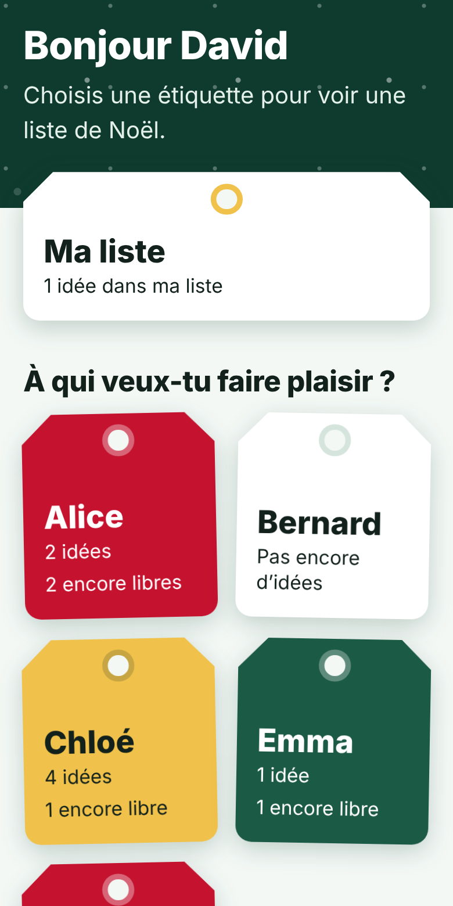
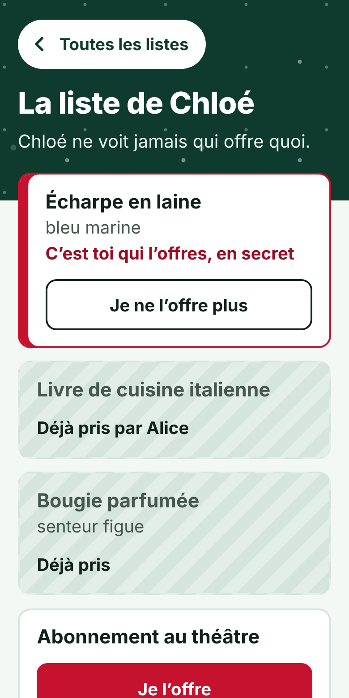
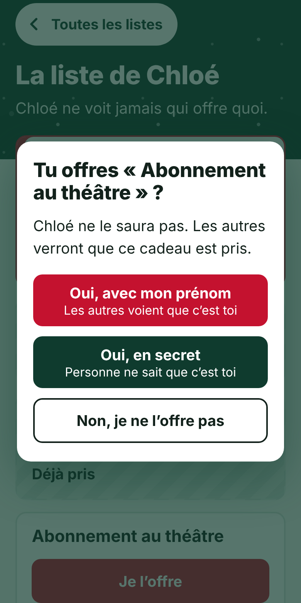

# Nos envies de Noël

Une petite application de listes de souhaits pour la famille. Chacun écrit sa liste,
tout le monde voit les listes des autres et peut dire « Je l'offre », avec son prénom
ou en secret. Celui qui a écrit la liste ne voit jamais qui offre quoi : la surprise reste entière,
et plus personne n'achète deux fois le même cadeau.

Elle a été pensée pour être utilisée par toute la famille, grands-parents compris :
pas de compte, pas de mot de passe, de gros boutons, des textes lisibles.

<p>
  
  
  
</p>

## Ce que fait l'application

- Chaque personne reçoit un lien personnel. Elle l'ouvre, elle est chez elle.
- Dans sa propre liste : ajouter ou retirer une idée, avec une précision facultative (taille, couleur, magasin).
- Dans la liste des autres : un bouton « Je l'offre », puis le choix « avec mon prénom » ou « en secret ».
- Un cadeau pris apparaît comme tel pour les autres. Il n'apparaît jamais comme pris pour celui qui l'a demandé.
- Si quelqu'un retire une idée déjà réservée, la personne qui comptait l'offrir est prévenue, et elle seule.
- L'accueil rappelle à chacun ce qu'il a prévu d'offrir.

## Comment le secret est tenu

Le serveur n'envoie jamais au propriétaire d'une liste la moindre information sur les réservations
de ses propres idées. Ce n'est pas un simple masquage à l'écran : l'information ne quitte pas le serveur.
Le fichier `scripts/test.mjs` le vérifie (`npm test`).

Une limite à connaître : il n'y a pas de mot de passe. Le lien personnel fait office de clé.
Celui qui possède le lien de quelqu'un d'autre voit ce que voit cette personne. C'est un compromis
adapté à une famille, pas à un usage où les participants ne se font pas confiance.
Envoyez donc chaque lien en message privé.

## Installer sa propre version

Il faut un compte GitHub et un compte Vercel. Les formules gratuites suffisent largement pour une famille.

1. **Copier ce dépôt** dans votre compte GitHub (bouton « Fork », ou « Use this template » s'il est proposé).
2. **Importer le dépôt dans Vercel** : « Add New », « Project », puis choisir le dépôt. Aucun réglage de build n'est nécessaire.
3. **Ajouter deux réglages** dans « Environment Variables » :
   - `CLE_FAMILLE` : une longue suite de caractères que vous inventez. Elle sert à fabriquer les liens personnels. Par exemple, dans un terminal : `openssl rand -hex 24`.
   - `FAMILLE` : les prénoms séparés par des virgules, dans l'ordre d'affichage. Par exemple : `Alice,Bernard,Chloé,David,Emma,Félix`.
4. **Créer la base de données** : onglet « Storage » du projet, « Create Database », choisir Neon (Postgres), formule gratuite, et la relier au projet. Vercel ajoute seul le réglage `DATABASE_URL`.
5. **Redéployer** le projet, pour qu'il prenne en compte la base.
6. **Générer les liens personnels** sur votre ordinateur (il faut Node.js, version 20 ou plus récente) :

   ```
   cp .env.example .env.local
   ```

   Ouvrez `.env.local` et mettez-y exactement les mêmes valeurs `CLE_FAMILLE` et `FAMILLE` que dans Vercel, puis :

   ```
   npm run liens -- https://votre-adresse.vercel.app
   ```

7. **Envoyer à chacun son lien**, en message privé. Pour les moins à l'aise, ajoutez le lien à l'écran d'accueil du téléphone ou de la tablette : ils auront une icône et n'auront plus besoin du lien.

Le fichier `vercel.json` fait tourner l'application à Francfort. Changez la région si votre famille vit ailleurs.

## Essayer sur son ordinateur

```
npm install
npm run dev
```

Le terminal affiche un lien de test par personne, pour une famille d'exemple. Sans base de données,
les listes sont enregistrées dans un simple fichier, dans le dossier `.data/`.

## À savoir

- Changer `CLE_FAMILLE` change tous les liens.
- Ajouter un prénom à `FAMILLE` ne change pas les liens des autres.
- Modifier l'orthographe d'un prénom revient à créer une nouvelle personne, avec une liste vide et un nouveau lien.
- L'application est en français et tutoie ses utilisateurs. Tous les textes sont dans `public/index.html`.

## Comment c'est construit

| Dossier ou fichier | Rôle |
| --- | --- |
| `public/index.html` | Tout ce que l'on voit à l'écran, en une seule page, sans framework. |
| `api/state.js` | Renvoie ce que la personne connectée a le droit de voir. |
| `api/action.js` | Ajouter, retirer, offrir, ne plus offrir. |
| `lib/core.js` | Les règles, dont le secret. |
| `lib/store.js` | Le stockage : Postgres en ligne, simple fichier en local. |
| `lib/auth.js` | Les liens personnels. |
| `lib/people.js` | La lecture des prénoms. |
| `dev.mjs` | Un petit serveur pour essayer sur son ordinateur. |
| `scripts/liens.mjs` | Affiche le lien personnel de chacun. |
| `scripts/test.mjs` | Vérifie que le secret est tenu. |

## Licence et esprit du projet

Ce projet est né d'un besoin familial et il est partagé tel quel, sous licence MIT : vous pouvez
l'utiliser, le copier et l'adapter librement. Il est fourni sans garantie et sans support.

Imaginé par Xavier Teichmann, codé avec l'aide de Claude (Anthropic).
